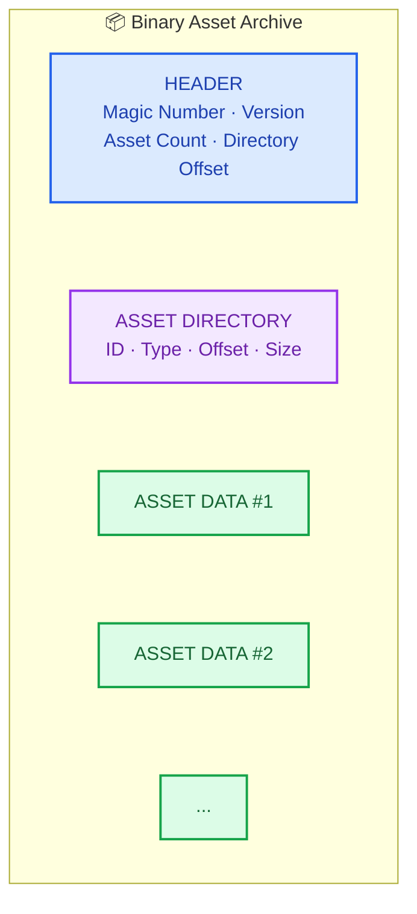
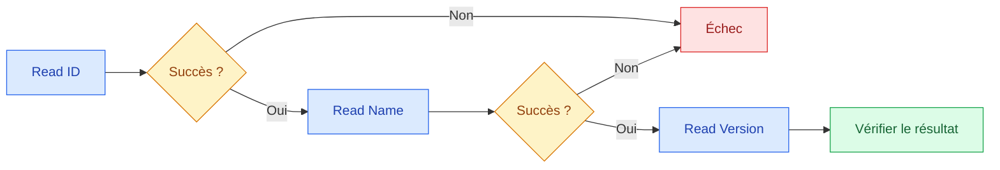
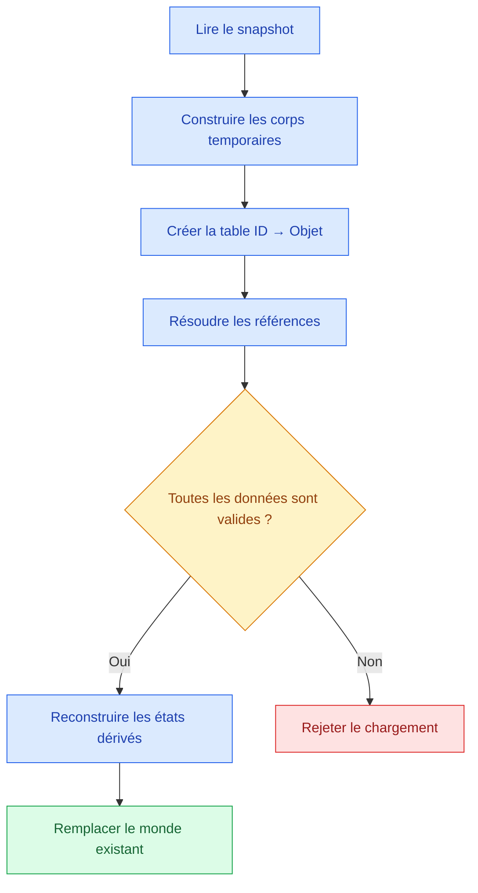

# 📦 Asset Engine - Fiche de révision

> **Gaming Campus - GTech 3 · Filière Moteur**
>
> Cette fiche reprend les notions étudiées en cours : formats binaires, organisation des archives, représentation mémoire, sérialisation, gestion des erreurs et introduction à la réflexion statique en C++20.

## 🎯 Objectifs

À la fin du module, vous devez être capables de :

- Comprendre et concevoir un format de fichier binaire.
- Sérialiser des valeurs C++ indépendamment de leur représentation mémoire.
- Construire un système de lecture et d'écriture robuste.
- Organiser plusieurs assets dans une archive avec un accès par identifiant.
- Détecter les données invalides ou corrompues.
- Gérer les versions et l'évolution des données.
- Réutiliser ce système pour sauvegarder et restaurer un état de moteur physique.

> [!IMPORTANT]
> **Sérialiser un objet ne signifie pas copier sa mémoire dans un fichier.**
>
> Un format binaire définit un contrat précis entre l'écriture et la lecture : types, tailles, ordre des octets, organisation et règles de validation.

---

## 📑 Sommaire

1. [Anatomie d'un format binaire](#1--anatomie-dun-format-binaire)
2. [Intégrité, CRC et collisions](#2--intégrité-crc-et-collisions)
3. [Pourquoi utiliser des bundles ?](#3--pourquoi-utiliser-des-bundles-)
4. [Représentation mémoire et sérialisation](#4--représentation-mémoire-et-sérialisation)
5. [Endianness et encodage](#5--endianness-et-encodage)
6. [BinaryWriter et BinaryReader](#6--binarywriter-et-binaryreader)
7. [Architecture d'une archive](#7--architecture-dune-archive)
8. [Validation et gestion des erreurs](#8--validation-et-gestion-des-erreurs)
9. [Fluent API et court-circuit](#9--fluent-api-et-court-circuit)
10. [Versioning et migrations](#10--versioning-et-migrations)
11. [Reflection statique en C++20](#11--reflection-statique-en-c20)
12. [Application au moteur physique](#12--application-au-moteur-physique)
13. [Performances et benchmarks](#13--performances-et-benchmarks)
14. [Questions de révision](#14--questions-de-révision)
15. [Checklist du projet](#15--checklist-du-projet)

---

## 1. 🧱 Anatomie d'un format binaire

Un fichier binaire est une suite d'octets.

Ces octets n'ont pas de signification intrinsèque : **leur interprétation dépend du format défini**.

### Structure typique d'une archive



*Le schéma représente l'organisation logique du fichier, et non le layout mémoire de structures C++.*

### Magic number

Un **magic number** est une signature utilisée pour reconnaître un format.

| Format | Signature courante |
|---|---|
| PNG | `89 50 4E 47 0D 0A 1A 0A` |
| ZIP | `50 4B 03 04` pour un en-tête de fichier |
| Archive personnalisée | Par exemple `GAST` |

> [!WARNING]
> Un magic number valide permet d'identifier un format attendu, **pas de prouver que l'intégralité du fichier est valide**.

### Header

Le *header* contient des informations nécessaires à l'interprétation du fichier.

Dans notre exemple :

| Champ | Description |
|---|---|
| Magic | Identifie le format |
| Version | Indique la version du format |
| Asset Count | Nombre d'assets |
| Directory Offset | Position du répertoire dans le fichier |

Les types, tailles et encodages de ces champs doivent être définis explicitement.

### Exemple réel : PNG

PNG repose sur une signature suivie d'une succession de *chunks*.

```text
┌─────────────────────┐
│ Length      4 bytes │
├─────────────────────┤
│ Type        4 bytes │
├─────────────────────┤
│ Data        N bytes │
├─────────────────────┤
│ CRC         4 bytes │
└─────────────────────┘
```

Quelques chunks :

| Chunk | Rôle |
|---|---|
| `IHDR` | Dimensions, profondeur et type de couleur |
| `PLTE` | Palette de couleurs |
| `IDAT` | Données d'image compressées |
| `IEND` | Fin du PNG |

Le CRC d'un chunk PNG couvre son **type et ses données**, pas son champ `Length`.

#### Palette et indirection

En mode couleurs indexées, les pixels stockent des indices vers une palette plutôt que leurs couleurs RGB complètes.

```text
Palette :
0 -> (255,   0,   0)
1 -> (  0, 255,   0)
2 -> (  0,   0, 255)

Pixels :
[0, 1, 0, 2, 2, 1]
```

Cela peut réduire la taille des données lorsque l'image utilise peu de couleurs.

On retrouve un principe d'**indirection** dans les archives d'assets :

```text
Asset ID -> Directory Entry -> File Offset -> Asset Data
```

> [!NOTE]
> La palette sert surtout à compacter la représentation de couleurs. Le répertoire d'assets sert surtout à localiser efficacement des ressources.
>
> Le mécanisme d'indirection est similaire, mais les objectifs sont différents.

---

## 2. 🔐 Intégrité, CRC et collisions

### Qu'est-ce qu'un checksum ?

Un *checksum* est une valeur calculée à partir de données pour aider à détecter des modifications.

Imaginons un calcul volontairement très simplifié :

```text
Checksum = (somme des octets) modulo 256
```

| Données | Checksum |
|---|---|
| `[10, 20, 30]` | `60` |
| `[20, 10, 30]` | `60` |
| `[10, 20, 31]` | `61` |

Les deux premières séquences sont différentes, mais produisent le même résultat.

C'est une **collision**.

### CRC-32

Le CRC-32 utilise une division polynomiale sur les bits et possède de meilleures propriétés de détection d'erreurs qu'une simple somme.

Il permet notamment de détecter efficacement de nombreuses corruptions accidentelles.

Cependant :

- Son résultat reste limité à 32 bits.
- Les collisions restent possibles.
- Ce n'est pas un mécanisme d'authentification cryptographique.

Une bibliothèque comme [zlib](https://zlib.net/manual.html) peut calculer un CRC-32 sans devoir réimplémenter l'algorithme.

> [!TIP]
> Pour votre archive, demandez-vous **quels octets sont réellement protégés**.
>
> Vérifier les payloads ne suffit pas nécessairement si le répertoire contenant leurs offsets peut lui aussi être corrompu.

### Hash Git et vérification Steam

Ces deux exemples permettent d'illustrer le concept d'empreinte de données.

**Git**

Les objets Git, notamment les commits, sont identifiés à l'aide de hashes cryptographiques.

Un commit inclut des métadonnées et des références à d'autres objets : son hash n'est pas simplement l'empreinte du texte des fichiers modifiés.

**Steam**

Lorsqu'une plateforme vérifie une installation, elle peut comparer les données locales à des informations de référence, puis récupérer les données nécessaires à la réparation.

Il n'est donc pas nécessaire de retélécharger systématiquement un jeu entier de 200 Go pour détecter ou corriger une partie endommagée.

> [!IMPORTANT]
> **Intégrité ≠ validité ≠ authenticité**
>
> - **Intégrité** : les données correspondent-elles à une référence ?
> - **Validité** : respectent-elles les règles du format ?
> - **Authenticité** : proviennent-elles d'une source digne de confiance ?

---

## 3. 📦 Pourquoi utiliser des bundles ?

Un jeu peut contenir plusieurs milliers d'assets : textures, modèles, sons, shaders, données de scènes, etc.

Plutôt que d'utiliser uniquement des fichiers indépendants, un moteur peut les regrouper dans des archives volumineuses.

### Avantages et inconvénients

| Avantages possibles | Inconvénients possibles |
|---|---|
| Moins de fichiers à ouvrir | Mises à jour plus complexes |
| Regroupement des accès | Reconstruction d'archives |
| Distribution simplifiée | Gestion des modifications |
| Compression mutualisée | Complexité du format |
| Meilleure organisation des données | Granularité parfois limitée |

> [!NOTE]
> Un bundle de 15 Go n'est pas automatiquement plus rapide qu'un ensemble de petits fichiers.
>
> Les performances dépendent de l'organisation des données, des accès, du stockage et des stratégies de chargement.

### Le rôle du répertoire d'assets

Une entrée du répertoire pourrait être représentée en C++ par :

```cpp
struct AssetEntry
{
    std::uint64_t id;
    std::uint32_t type;
    std::uint64_t offset;
    std::uint64_t size;
};
```

| Champ | Utilité |
|---|---|
| `id` | Identifier l'asset |
| `type` | Connaître son type |
| `offset` | Trouver sa position dans l'archive |
| `size` | Connaître sa taille sérialisée |

Avec cette information, il devient possible d'accéder directement à un asset sans décoder tous ceux qui le précèdent.

---

## 4. 🧠 Représentation mémoire et sérialisation

### `sizeof`, padding et alignment

Considérons cette structure :

```cpp
#include <cstddef>
#include <cstdint>
#include <iostream>

struct Header
{
    char magic[4];
    std::uint8_t version;
    std::uint64_t directoryOffset;
};

int main()
{
    std::cout << "Size: " << sizeof(Header) << '\n';
    std::cout << "Alignment: " << alignof(Header) << '\n';

    std::cout << "Directory offset: "
              << offsetof(Header, directoryOffset)
              << '\n';
}
```

Les membres représentent :

```text
4 + 1 + 8 = 13 octets
```

Pourtant, sur de nombreuses plateformes x64, `sizeof(Header)` vaut **16 octets**.

Pourquoi ?

Le compilateur peut insérer des octets de *padding* pour satisfaire les contraintes d'alignement.

> [!WARNING]
> **`sizeof(T)` ne définit pas la taille sérialisée de `T`.**
>
> Le layout dépend notamment de l'ABI, de l'alignement et de l'implémentation.

### Le piège du `reinterpret_cast`

```cpp
struct Asset
{
    std::uint32_t id;
    std::string name;
    float mass;
};

Asset asset{42, "Player", 75.0f};

file.write(
    reinterpret_cast<const char*>(&asset),
    sizeof(asset)
);
```

Ce code copie la représentation mémoire de l'objet.

Il ne définit **pas** un format de sauvegarde fiable.

Problèmes possibles :

- Représentation interne de `std::string`.
- Pointeurs et allocations dynamiques.
- Padding.
- Endianness.
- Différences entre compilateurs et plateformes.

La *Small String Optimization* peut faire apparaître les caractères d'une petite chaîne dans le dump mémoire, sans rendre celui-ci portable.

> [!TIP]
> `reinterpret_cast` n'est pas intrinsèquement mauvais.
>
> Il peut être approprié pour transmettre à `std::ofstream::write` un **buffer d'octets déjà sérialisés**.
>
> Ce qui pose problème, c'est d'utiliser directement la représentation mémoire d'un objet comme format persistant.

---

## 5. 🔢 Endianness et encodage

Prenons :

```cpp
std::uint32_t value = 0x12345678;
```

### Little-endian vs big-endian

```text
Valeur : 0x12345678

Little-endian :
+----+----+----+----+
| 78 | 56 | 34 | 12 |
+----+----+----+----+

Big-endian :
+----+----+----+----+
| 12 | 34 | 56 | 78 |
+----+----+----+----+
```

En C++20, `std::endian` permet d'examiner l'endianness native :

```cpp
#include <bit>

if constexpr (std::endian::native == std::endian::little)
{
    // Machine little-endian
}
```

Mais le fichier doit utiliser un encodage **choisi par le format**, indépendamment de la machine.

### Écriture explicite d'un `uint32_t`

```cpp
void WriteU32(std::uint32_t value)
{
    for (int i = 0; i < 4; ++i)
    {
        WriteU8(static_cast<std::uint8_t>(value));
        value >>= 8;
    }
}
```

Cette fonction écrit les octets dans l'ordre little-endian.

Pour `0x12345678`, elle produit :

```text
78 56 34 12
```

### Autres types

Un format doit aussi définir comment représenter :

- Les booléens (par exemple `0` ou `1`).
- Les entiers signés.
- Les flottants.
- Les chaînes UTF-8.
- Les collections de taille variable.

Pour les flottants, `std::bit_cast` (C++20) peut aider à travailler sur leur représentation binaire.

Cela ne dispense pas de définir précisément la représentation attendue dans le fichier.

---

## 6. 💾 BinaryWriter et BinaryReader

L'objectif est de séparer :

1. Les opérations sur les octets.
2. L'organisation du format d'archive.
3. La sérialisation des types métier.

Un `BinaryWriter` ne devrait pas avoir besoin de connaître `Player`, `Texture` ou `RigidBody`.

### Exemple : Writer minimal

```cpp
#include <cstddef>
#include <cstdint>
#include <limits>
#include <span>
#include <stdexcept>
#include <string_view>
#include <vector>

class BinaryWriter
{
public:
    void WriteU8(std::uint8_t value)
    {
        m_buffer.push_back(std::byte{value});
    }

    void WriteU32(std::uint32_t value)
    {
        for (int i = 0; i < 4; ++i)
        {
            WriteU8(static_cast<std::uint8_t>(value));
            value >>= 8;
        }
    }

    void WriteString(std::string_view text)
    {
        if (text.size() >
            std::numeric_limits<std::uint32_t>::max())
        {
            throw std::length_error("String too large");
        }

        WriteU32(static_cast<std::uint32_t>(text.size()));

        for (unsigned char c : text)
        {
            WriteU8(c);
        }
    }

    std::span<const std::byte> Bytes() const
    {
        return m_buffer;
    }

private:
    std::vector<std::byte> m_buffer;
};
```

### Exemple d'utilisation

```cpp
BinaryWriter writer;

writer.WriteU8('G');
writer.WriteU8('A');
writer.WriteU8('S');
writer.WriteU8('T');

writer.WriteU32(1);
writer.WriteU32(42);
writer.WriteString("Player");
```

Résultat :

```text
47 41 53 54 | 01 00 00 00 | 2A 00 00 00 | 06 00 00 00 | 50 6C 61 79 65 72
    GAST         Version 1       ID 42        Length 6          Player
```

### Exemple : Reader minimal

```cpp
#include <cstddef>
#include <cstdint>
#include <span>
#include <string>
#include <utility>

class BinaryReader
{
public:
    explicit BinaryReader(std::span<const std::byte> bytes)
        : m_bytes(bytes)
    {
    }

    bool ReadU32(std::uint32_t& value)
    {
        if (m_cursor > m_bytes.size() ||
            m_bytes.size() - m_cursor < 4)
        {
            return false;
        }

        std::uint32_t result = 0;

        for (int i = 0; i < 4; ++i)
        {
            result |=
                std::uint32_t(
                    std::to_integer<std::uint8_t>(
                        m_bytes[m_cursor + i]
                    )
                ) << (8 * i);
        }

        m_cursor += 4;
        value = result;

        return true;
    }

    bool ReadString(std::string& value)
    {
        const std::size_t start = m_cursor;
        std::uint32_t length = 0;

        if (!ReadU32(length))
        {
            return false;
        }

        constexpr std::uint32_t MaxLength = 1024 * 1024;

        if (length > MaxLength ||
            m_cursor > m_bytes.size() ||
            length > m_bytes.size() - m_cursor)
        {
            m_cursor = start;
            return false;
        }

        std::string result;
        result.reserve(length);

        for (std::uint32_t i = 0; i < length; ++i)
        {
            result.push_back(static_cast<char>(
                std::to_integer<unsigned char>(
                    m_bytes[m_cursor + i]
                )));
        }

        m_cursor += length;
        value = std::move(result);

        return true;
    }

private:
    std::span<const std::byte> m_bytes;
    std::size_t m_cursor = 0;
};
```

*Les deux classes sont à utiliser ensemble, avec leurs en-têtes. Il s'agit d'une démonstration des primitives, et non d'une bibliothèque d'archives complète.*

### Round-trip

Un *round-trip* consiste à vérifier que :

```text
Valeur originale
       |
       v
   Serialize
       |
       v
   Binary Data
       |
       v
  Deserialize
       |
       v
Valeur reconstruite
```

La valeur reconstruite doit être équivalente à la valeur originale selon les règles du format.

Exemple avec les classes précédentes :

```cpp
BinaryWriter writer;
writer.WriteU32(42);
writer.WriteString("Player");

BinaryReader reader(writer.Bytes());

std::uint32_t id = 0;
std::string name;

if (reader.ReadU32(id) && reader.ReadString(name))
{
    // id == 42
    // name == "Player"
}
```

> [!NOTE]
> `std::span` ne copie pas les données et ne possède pas le buffer.
>
> Le buffer original doit rester vivant tant que le Reader l'utilise. Une modification du Writer qui réalloue son `vector` peut invalider les vues précédemment obtenues.

---

## 7. 🗂️ Architecture d'une archive

Une archive ne doit pas obligatoirement être représentée en mémoire comme elle l'est sur disque.

### Format sérialisé et représentation runtime

Sur disque, on peut utiliser une suite compacte d'entrées de taille fixe.

En mémoire, on pourrait utiliser :

```cpp
using AssetDirectory =
    std::unordered_map<std::uint64_t, AssetEntry>;
```

Cela permet de rechercher un asset par identifiant.

| Représentation | Recherche | Caractéristique |
|---|---|---|
| `std::vector` non trié | O(n) | Compact |
| `std::vector` trié | O(log n) | Compact, recherche binaire |
| `std::unordered_map` | O(1) en moyenne | Accès rapide, overhead mémoire |

### Exemple de calcul d'offset

Supposons que le format fixe :

**Header :**

| Champ | Taille |
|---|---:|
| Magic | 4 |
| Version | 4 |
| Asset Count | 4 |
| Directory Offset | 8 |
| **Total** | **20 octets** |

**Directory entry :**

| Champ | Taille |
|---|---:|
| ID | 8 |
| Type | 4 |
| Offset | 8 |
| Size | 8 |
| **Total** | **28 octets** |

Pour trois assets, si le répertoire est placé immédiatement après le header :

```text
Header :       20 octets
Directory : 3 * 28 octets
-------------------------
Premier payload : offset 104
```

Ces tailles sont celles du **format explicitement encodé**, pas les `sizeof` de structures C++.

### Comment écrire le répertoire ?

Plusieurs approches existent :

- Calculer toutes les tailles et positions avant l'écriture.
- Réserver l'espace du répertoire puis revenir le remplir.
- Écrire les payloads d'abord et placer le répertoire à la fin.

Les opérations `seekg` et `seekp` permettent de repositionner les curseurs des flux de fichiers.

> [!TIP]
> Pour accéder à un asset, le lecteur peut :
>
> 1. Lire et valider le header.
> 2. Charger le répertoire.
> 3. Rechercher l'ID demandé.
> 4. Vérifier l'offset et la taille.
> 5. Lire uniquement la plage correspondante.

---

## 8. 🛡️ Validation et gestion des erreurs

### `assert` n'est pas une validation de fichier

Un `assert` sert principalement à vérifier un invariant interne de programmation.

```cpp
assert(m_initialized);
```

Lorsque `NDEBUG` est défini, l'expression d'un `assert` standard n'est pas évaluée.

C'est fréquent dans les configurations Release, même si le standard C++ n'impose pas cette association.

**Code dangereux :**

```cpp
assert(m_cursor + 4 <= m_data.size());

// Lecture des quatre octets
```

En l'absence de vérification runtime, un fichier tronqué peut provoquer un accès mémoire invalide.

**Validation correcte :**

```cpp
if (m_cursor > m_data.size() ||
    m_data.size() - m_cursor < 4)
{
    return false;
}
```

### Choisir un mécanisme d'erreur

| Mécanisme | Usage |
|---|---|
| `assert` | Violation d'un invariant interne |
| `throw` | Signalement d'une erreur via exception |
| `bool` | Succès ou échec simple |
| `std::optional<T>` | Valeur ou absence de valeur |
| `Result<T, Error>` | Succès ou erreur détaillée |

`std::expected<T, E>` est disponible à partir de **C++23**.

> [!IMPORTANT]
> **Les erreurs causées par des données externes doivent être gérées en Release.**
>
> Le choix entre exceptions et valeurs de retour ne change pas cette obligation.

### Validation des offsets

Éviter :

```cpp
offset + size <= fileSize
```

L'addition peut déborder.

Préférer :

```cpp
bool IsValidRange(
    std::uint64_t offset,
    std::uint64_t size,
    std::uint64_t fileSize)
{
    return offset <= fileSize &&
           size <= fileSize - offset;
}
```

### Autres validations essentielles

- Magic number incorrect.
- Version inconnue.
- Offset hors du fichier.
- Taille dépassant les données restantes.
- Longueur de collection excessive.
- Identifiants dupliqués.
- Type d'asset invalide.
- Checksum incorrect.
- Référence vers un objet inexistant.

---

## 9. 🔗 Fluent API et court-circuit

Une *Fluent API* permet de chaîner des opérations.

Par exemple :

```cpp
reader.Read(id).Read(name).Read(version);
```

Mais comment éviter qu'une lecture suivante ait lieu après un échec ?

### Principe du breaker



### Exemple avec une chaîne de lecture

Cette classe utilise le `BinaryReader` de la section précédente :

```cpp
class ReadChain
{
public:
    explicit ReadChain(BinaryReader& reader)
        : m_reader(reader)
    {
    }

    ReadChain& Read(std::uint32_t& value)
    {
        if (m_ok)
        {
            m_ok = m_reader.ReadU32(value);
        }

        return *this;
    }

    ReadChain& Read(std::string& value)
    {
        if (m_ok)
        {
            m_ok = m_reader.ReadString(value);
        }

        return *this;
    }

    explicit operator bool() const
    {
        return m_ok;
    }

private:
    BinaryReader& m_reader;
    bool m_ok = true;
};
```

Utilisation :

```cpp
std::uint32_t id = 0;
std::string name;

ReadChain chain(reader);

if (chain.Read(id).Read(name))
{
    // Les deux lectures ont réussi
}
```

Après le premier échec, les appels suivants retournent immédiatement.

C'est un **court-circuit logique** : les appels de méthodes ont toujours lieu, mais ne réalisent plus d'opérations de lecture.

### Alternatives en C++20

Une autre approche consiste à utiliser `std::optional` pour propager l'échec :

```cpp
std::optional<std::uint32_t> ReadU32();
```

On peut également combiner :

- `std::tuple` pour regrouper plusieurs valeurs.
- `std::apply` pour les parcourir.
- Une fold expression `&&` pour court-circuiter des lectures.

C'est intéressant pour une API générique, mais une `ReadChain` reste souvent plus simple à présenter et à utiliser.

> [!WARNING]
> Une chaîne fluide ne garantit pas une restauration atomique.
>
> Si `Read(id)` et `Read(name)` réussissent mais que `Read(version)` échoue, les premières valeurs ont déjà pu être modifiées.
>
> Pour charger un asset complet, utilisez un objet temporaire, validez l'ensemble, puis appliquez le résultat.

---

## 10. 🕒 Versioning et migrations

Un format doit pouvoir évoluer sans nécessairement rendre toutes les anciennes données inutilisables.

### Exemple : V1 → V2

```cpp
struct PlayerV1
{
    std::uint32_t health;
    float speed;
};

struct PlayerV2
{
    std::uint32_t health;
    float speed;
    std::uint32_t level = 1;
};
```

La V2 possède un nouveau champ.

La V1 ne contient aucune valeur pour `level`.

### Migration

```cpp
PlayerV2 Migrate(const PlayerV1& old)
{
    return {
        .health = old.health,
        .speed = old.speed,
        .level = 1
    };
}
```

La migration utilise une valeur par défaut documentée.

### Deux niveaux de versioning

| Niveau | Exemple |
|---|---|
| Version d'archive | Modification du header ou du directory |
| Version d'asset | Ajout d'un champ dans `Player` |

> [!IMPORTANT]
> Une version inconnue ne doit pas être interprétée arbitrairement comme une version connue.
>
> La bibliothèque doit sélectionner un décodage compatible ou refuser explicitement le chargement.

---

## 11. 🪞 Reflection statique en C++20

C++20 ne fournit pas de reflection native capable de découvrir automatiquement tous les membres d'un type.

On peut toutefois créer une forme d'introspection explicite.

### `std::tie` + `std::apply`

```cpp
#include <cstdint>
#include <iostream>
#include <string>
#include <tuple>

struct Player
{
    std::uint32_t health = 100;
    float speed = 5.0f;
    std::string name = "Alice";

    auto Reflect()
    {
        return std::tie(health, speed, name);
    }
};

template<typename T, typename Func>
void ForEachField(T& object, Func&& func)
{
    std::apply(
        [&](auto&... fields)
        {
            (func(fields), ...);
        },
        object.Reflect()
    );
}

int main()
{
    Player player;

    ForEachField(player, [](const auto& field)
    {
        std::cout << field << '\n';
    });
}
```

### Que se passe-t-il ?

1. `std::tie` construit un tuple de références.
2. `std::apply` décompose le tuple en arguments.
3. La fold expression applique une fonction à chaque champ.
4. Les types des champs restent connus à la compilation.

On pourrait ensuite réutiliser ce principe pour appeler une fonction de sérialisation adaptée à chaque champ.

### Limites

- Les champs doivent être explicitement exposés.
- Leur ordre peut devenir une contrainte de compatibilité.
- Les noms des champs ne sont pas automatiquement disponibles.
- Certains champs ne doivent pas être sérialisés.
- Les références et pointeurs nécessitent un traitement particulier.

> [!TIP]
> **La reflection automatise potentiellement le parcours des données, pas les décisions de sérialisation.**
>
> Le format reste responsable de la compatibilité, des encodages, des références et des validations.

---

## 12. ⚙️ Application au moteur physique

Les objets d'un moteur physique peuvent contenir des pointeurs vers d'autres objets.

```cpp
struct Joint
{
    RigidBody* bodyA;
    RigidBody* bodyB;
};
```

Enregistrer directement les adresses mémoire n'a pas de sens : elles ne sont pas stables entre deux exécutions.

### Utiliser des IDs persistants

```cpp
struct SavedJoint
{
    std::uint64_t bodyAId;
    std::uint64_t bodyBId;
};
```

### Reconstruction d'un snapshot



Les données sauvegardées peuvent inclure :

- Gravité et pas de simulation fixe.
- Identifiants des corps.
- État statique ou dynamique.
- Position et orientation.
- Masse et inertie.
- Vitesses linéaire et angulaire.
- Paramètres des colliders.

Les caches et autres états dérivés peuvent nécessiter une reconstruction après chargement.

> [!WARNING]
> Un snapshot invalide ne doit pas laisser le monde physique dans un état partiellement restauré.

---

## 13. 📈 Performances et benchmarks

Une optimisation doit être vérifiée par des mesures.

### Sources possibles de surcoût

| Problème | Piste d'amélioration |
|---|---|
| Copies répétées de buffers | `std::span`, références |
| Allocations trop fréquentes | `reserve`, réutilisation |
| Lectures octet par octet sur disque | Lectures groupées |
| Recherche linéaire répétée | Index adapté |
| Chargement de tous les assets | Accès direct par offset |
| Conversions intermédiaires inutiles | Encodage direct dans un buffer |

### Comparer deux volumes de données

Mesurer au minimum :

| Mesure | Petit volume | Grand volume |
|---|---|---|
| Taille finale | À mesurer | À mesurer |
| Temps de sauvegarde | À mesurer | À mesurer |
| Temps de chargement | À mesurer | À mesurer |
| Mémoire temporaire | À mesurer | À mesurer |

Les volumes et conditions de mesure doivent être reproductibles.

> [!NOTE]
> Éviter une copie ne garantit pas automatiquement une accélération.
>
> Mesurez en configuration pertinente, sur plusieurs exécutions, avec des données représentatives.

---

## 14. 🧩 Questions de révision

Essayez d'abord de répondre sans consulter les sections précédentes.

### Fondamentaux

- [ ] Pourquoi `sizeof(T)` ne définit-il pas la taille sérialisée d'un objet ?
- [ ] Que représente un magic number ?
- [ ] Pourquoi un fichier peut-il avoir un checksum correct tout en étant invalide ?
- [ ] Quelle est la différence entre little-endian et big-endian ?
- [ ] Pourquoi un `std::string` ne doit-il pas être sauvegardé par dump mémoire ?

### Architecture

- [ ] Quel est l'intérêt d'un asset directory ?
- [ ] Comment retrouver un asset sans lire tous les précédents ?
- [ ] Pourquoi le répertoire en mémoire peut-il différer du répertoire sur disque ?
- [ ] Comment gérer un nouvel attribut dans une ancienne sauvegarde ?
- [ ] Pourquoi sauvegarder des IDs plutôt que des pointeurs ?

### Robustesse

- [ ] Pourquoi `assert` ne remplace-t-il pas une validation runtime ?
- [ ] Comment éviter un overflow lors de la validation d'un offset ?
- [ ] Que faire si le fichier indique une collection de plusieurs milliards d'éléments ?
- [ ] Pourquoi une Fluent API ne garantit-elle pas un chargement atomique ?
- [ ] Quelle différence entre `std::optional` et un résultat avec code d'erreur ?

<details>
<summary><strong>💡 Indices et éléments de correction</strong></summary>

**Représentation mémoire :** padding, alignement, pointeurs, différences d'implémentation et encodages.

**Magic number :** reconnaissance du format attendu, sans garantie sur le contenu restant.

**Checksum :** collisions possibles ; l'intégrité n'assure pas la validité sémantique.

**Endianness :** ordre des octets pour représenter des valeurs multioctets.

**Répertoire :** ID → type, offset, taille ; possibilité d'accès direct.

**Versioning :** décodeurs adaptés, migrations explicites et valeurs par défaut.

**IDs :** les identifiants restent significatifs après de nouvelles allocations mémoire.

**Assertions :** elles peuvent être désactivées avec `NDEBUG`.

**Offsets :** vérifier `offset <= fileSize` puis `size <= fileSize - offset`.

**Allocations :** imposer des limites et vérifier les données disponibles avant d'allouer.

**Atomicité :** construire et valider un résultat temporaire avant de modifier l'état existant.

**Gestion d'erreurs :** `std::optional` représente une absence de valeur, tandis qu'un `Result<T, Error>` peut indiquer la cause de l'échec.

</details>

---

## 15. ✅ Checklist du projet

### Format

- [ ] Magic number défini.
- [ ] Version du format définie.
- [ ] Endianness documentée.
- [ ] Encodage des primitives défini.
- [ ] Header documenté.
- [ ] Asset directory documenté.
- [ ] Offsets et tailles définis précisément.

### Sérialisation

- [ ] Writer et Reader fonctionnels.
- [ ] Round-trip sur les types primitifs.
- [ ] Chaînes et collections prises en charge.
- [ ] Structures composites sérialisables.
- [ ] Pas de dump brut de structures contenant pointeurs ou conteneurs.
- [ ] Adapters séparés des opérations bas niveau.

### Robustesse

- [ ] Validation active en Release.
- [ ] Gestion des fichiers tronqués.
- [ ] Validation des offsets et tailles.
- [ ] Limitation des allocations.
- [ ] Vérification des IDs dupliqués.
- [ ] Vérification des références.
- [ ] Contrôle d'intégrité documenté.
- [ ] Versions inconnues rejetées.
- [ ] Gestion des échecs d'écriture.
- [ ] Pas d'état partiellement restauré après erreur.

### Intégration

- [ ] Plusieurs assets dans une archive.
- [ ] Recherche et lecture par ID.
- [ ] Migration entre deux versions de schéma.
- [ ] Snapshot du moteur physique.
- [ ] Reconstruction des références et états dérivés.
- [ ] Tests automatisés.
- [ ] Benchmarks reproductibles.
- [ ] README d'utilisation.

---

## 📚 Références

| Ressource | Sujet |
|---|---|
| [cppreference - `std::byte`](https://en.cppreference.com/w/cpp/types/byte) | Manipulation d'octets |
| [cppreference - `std::span`](https://en.cppreference.com/w/cpp/container/span) | Vues non propriétaires |
| [cppreference - `std::bit_cast`](https://en.cppreference.com/w/cpp/numeric/bit_cast) | Représentation binaire |
| [cppreference - `std::optional`](https://en.cppreference.com/w/cpp/utility/optional) | Résultats optionnels |
| [W3C - PNG Specification](https://www.w3.org/TR/png-3/) | Exemple de format structuré |
| [zlib Manual](https://zlib.net/manual.html) | CRC-32 |
| [Git Internals](https://git-scm.com/book/en/v2/Git-Internals-Git-Objects) | Objets et hashes Git |

---

### 🧠 À retenir

> [!IMPORTANT]
> **Un bon format binaire ne se résume pas à écrire des octets.**
>
> Il doit permettre de comprendre précisément :
>
> - **Quoi** écrire.
> - **Comment** l'encoder.
> - **Où** retrouver les données.
> - **Comment** vérifier leur validité.
> - **Comment** gérer les évolutions.
> - **Comment** échouer proprement.
>
> **Le Writer et le Reader doivent respecter le même contrat, indépendamment de la représentation mémoire des objets C++.**
